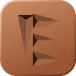
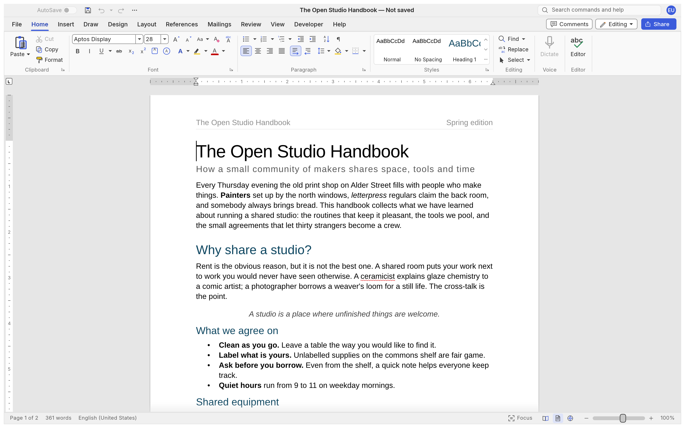
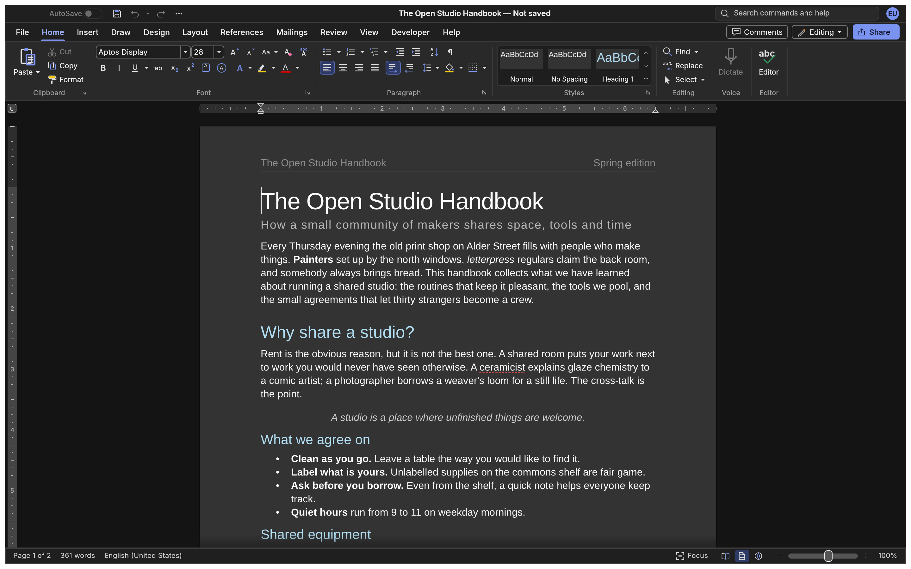

<h1 align="center">Etch</h1>

<p align="center">
  
</p>

<p align="center">
  <b>A free, open-source word processor in pure Rust that works the way Word does and keeps your writing safe.</b>
</p>

<p align="center">
  Etch is a hardened fork of <a href="https://github.com/storytold/wordcraft">WordCraft</a>, a clean-room
  reimplementation of Microsoft Word written by the ArtCraft team. It aims to be a worthy alternative to Word and
  LibreOffice Writer for everyday writing: familiar, fast, and never careless with your files.
</p>

<p align="center">
  
  
  
  
</p>

<p align="center">
  
  <br><sub>Etch with its built-in sample document: the ribbon, live styles, rulers and spelling as you type.</sub>
</p>

<p align="center">
  <a href="#what-etch-is">What Etch is</a> ·
  <a href="#how-etch-differs-from-wordcraft">How it differs from WordCraft</a> ·
  <a href="#what-works-today">What works today</a> ·
  <a href="#building-and-running">Building and running</a> ·
  <a href="#the-command-line">Command line</a> ·
  <a href="#how-etch-is-built">How Etch is built</a> ·
  <a href="#license-and-credits">License and credits</a>
</p>

## What Etch is

- **Familiar.** Word's ribbon, styles, shortcuts and editing behaviour. Enter continues a list, Tab
  demotes it, Ctrl/⌘+B bolds the word under the caret, F4 repeats, F7 checks spelling.
- **Safe with your writing.** Saves are written to a temporary file, flushed to disk and swapped in
  atomically. AutoSave runs in the background. Crash recovery keeps checksummed copies. If another
  program changes your file while it's open, Etch asks before overwriting it.
- **Your files.** Opens and saves .docx, and also .odt, .rtf, .html, .md, .tex and .txt. Opens Word
  97–2003 .doc. Exports PDF with real, selectable text, links and bookmarks.
- **Fast and light.** Typing re-lays out only what changed, undo steps share unchanged parts of the
  document, and long tables build their rows only when a page shows them.
- **Quiet.** No AI features, no accounts, no network services. Spelling, grammar and everything
  else work offline.
- **Open.** Free to use for anything, with no attribution required (0BSD). Clean-room: built from
  public specifications and observed behaviour, with every asset original or openly licensed.

Etch is **alpha** software. It is developed and tested on Linux. The code also builds for macOS,
Windows, the BSDs and the browser (WebAssembly), but Etch hasn't tested those builds yet and
publishes no releases.

## How Etch differs from WordCraft

Etch is an independent fork of WordCraft.

| | Etch |
|---|---|
| **Focus** | Durability first, then correctness, then speed, then a good dark mode. New features come after those. |
| **Saving** | A shared set of document limits for every reader and the editor, so whatever Etch saves it opens again. Hostile or oversized files are refused up front, with a clear reason. Tracked recovery copies, stale copies marked, a failed save never marks the document saved. |
| **Speed** | Incremental pagination while typing, copy-on-write undo, lazy table rows, PDF export reusing the window's layout, and no spell-checking pass during export. |
| **AI and automation** | None. The MCP server and agent features are removed. The JSON control channel exists only in test builds (the non-default `automation` feature); release builds open no socket. |
| **Scope** | No mail merge. Envelopes and labels stay, and merge fields in documents you receive are kept unchanged. |
| **Interface** | No community links. The Zotero tab starts hidden (Customize Ribbon shows it). The About box credits WordCraft. |
| **Name and files** | The app is `etch` and the command-line tool `etch-cli`. Settings live in Etch's own folder; the first start copies WordCraft's settings there and leaves the old folder alone. Files record Etch as the program that saved them. |
| **Clean room** | Stricter rules for contributors and agents: no GPL code, not even for names; nothing from leaked source; no downloaded documents; standard formats written in their own vocabulary. |

The crate names (`wordcraft-*`) and the `WORDCRAFT_*` environment variables are unchanged.

## What works today

| Area | Highlights |
|---|---|
| **Writing** | IME, smart quotes, AutoCorrect, list autoformat, dashes; word, sentence and paragraph selection; clipboard with formatting; undo and redo; find and replace with regular expressions |
| **Formatting** | Fonts, sizes, bold, italic and underline styles, strike, sub- and superscript, caps, highlight, colours, character spacing, Format Painter, Change Case, Clear Formatting |
| **Paragraphs** | Alignment, indents on the ruler, spacing, line spacing, tabs with leaders, borders, shading, keep with next, widow and orphan control |
| **Styles** | Built-in styles, live gallery, Styles pane, create, modify and update styles, style sets, themes |
| **Lists** | Bullets, numbering, multilevel lists, restart and set value, custom formats |
| **Tables** | Insert by grid, merge and split, table styles, borders, shading, repeated header rows, rows split across pages, sort, formulas, text to table |
| **Pages** | Margins, orientation, size, columns, breaks, headers and footers, page numbers, watermarks, page borders, line numbers, drop caps, automatic hyphenation |
| **Objects** | Pictures (crop, recolour, corrections, transparency, background removal, styles, rotation), shapes, text boxes, text wrapping |
| **References** | Tables of contents, footnotes and endnotes, citations and bibliographies (APA, MLA, Chicago, IEEE), captions, cross-references, index, table of authorities |
| **Review** | Spelling and grammar (English and Polish, by each run's language), thesaurus, word count, comments, track changes, compare documents, restrict editing, accessibility checker |
| **View** | Print layout, web layout, draft, read mode, focus, zoom, Navigation pane, rulers, dark mode; the interface in 23 languages, following the system language by default |
| **Files** | .docx read and write, .doc import, PDF export, .odt, .rtf, .html, .md, .tex and .txt import and export, page images |

Where Etch still falls short of Word is tracked in [ROADMAP.md](ROADMAP.md),
[the gaps list](docs/gaps.md) and the [parity assessment](docs/target-app-parity.md).

<p align="center">
  
  <br><sub>Dark mode. The pages follow the interface theme by default; Options can keep them light.</sub>
</p>

## Building and running

You need a Rust toolchain ([rustup](https://rustup.rs/)). On Linux, the usual graphics and font
development packages are needed as well.

```sh
git clone git@github.com:asystemoffields/Etch.git etch
cd etch
cargo run --release -p wordcraft -- --sample        # the desktop app with the sample document
cargo run --release -p wordcraft -- report.docx     # open a document
cargo build --release -p wordcraft -p wordcraft-cli # builds target/release/etch and etch-cli
```

The browser build: `cd apps/wordcraft-web && trunk serve`, then open <http://127.0.0.1:8771/?sample>.

The quality gate runs formatting, clippy, about 4,000 tests, the asset-attribution check, the
layering check and the WebAssembly build:

```sh
cargo xtask ci
```

**Logs** go to standard error and to `logs/etch.log` in the settings folder: on Linux
`~/.config/etch/logs/`, on macOS `~/Library/Application Support/Etch/logs/`, on Windows
`%APPDATA%\Etch\logs\`. Each start keeps the two previous logs, so the log of a run that crashed
survives. Document text is never logged. `RUST_LOG` takes env_logger-style directives, for example
`RUST_LOG=debug`.

**Graphics troubleshooting.** `WGPU_BACKEND` picks the graphics backend (`vulkan`, `dx12`, `metal`,
`gl`) if the default fails on your driver. On a Wayland desktop Etch runs through XWayland, because
dragging files into the window works only on X11; `WORDCRAFT_WAYLAND=1` uses native Wayland instead.

## The command line

`etch-cli` runs any of Etch's 617 commands without a window. Benchmarks and tests use it.

```sh
etch-cli convert report.docx report.pdf             # docx, pdf, odt, rtf, html, md, tex, txt, png
etch-cli text report.docx                           # plain text
etch-cli inspect report.docx                        # structure as JSON
etch-cli run --template sample \
  --cmd 'select.text={"text":"Membership"}' --cmd format.bold --save out.docx
etch-cli commands                                   # every command id, with labels and shortcuts
```

Macros record any sequence of commands and play it back (`tools.recordMacro`, `tools.macros`).

## How Etch is built

AI coding agents do most of the implementation, under written rules and a gate every change must
pass.

- **Architecture.** Sixteen crates in strict layers, checked by `cargo xtask layers`: the document
  model, fonts and proofing at the bottom; layout and the file formats above them; rendering and
  PDF; the engine with its session, undo and command registry; the egui interface on top. Every
  user-visible action is a command with an id. Details: [docs/architecture.md](docs/architecture.md).
- **Never crash.** No `unwrap`, `panic` or unchecked indexing in production code, enforced by lints.
  Input from files is treated as hostile and bounded. Every crash fix lands with a regression test.
- **Snapshots.** Golden layouts, saves, PDFs, rendered pages and command scripts pin behaviour, so a
  refactor that changes output fails the gate.
- **Agents.** Instructions for coding agents are in [AGENTS.md](AGENTS.md).

## Where Etch came from

Etch started as an idea I had what feels like years ago, a writing app I called
[Prose Code](https://github.com/asystemoffields/prose-code). It was a fun project I envisioned as a
hybrid of a text editor and a WP. I knew I wanted a fully developed WP someday, and planned to clone
one of the big ones, but I'm surprised to hit that goal so quickly. Cheers to Opus 5.5 and
Fable 5.1, and I'm grateful to WordCraft for doing the hardest part. — Alex

## License and credits

Etch's own work is under the [BSD Zero Clause License](LICENSE-0BSD): use it for anything, with no
conditions and no attribution required. The WordCraft code it builds on is MIT
([LICENSE-MIT](LICENSE-MIT)) or Apache-2.0 ([LICENSE-APACHE](LICENSE-APACHE)), at your option;
under MIT, keeping that licence file with a copy is the only condition. Details are in
[NOTICE](NOTICE).

Etch is based on [WordCraft](https://github.com/storytold/wordcraft) by the ArtCraft team. It is an
independent fork, not an ArtCraft product, and is not endorsed by the ArtCraft team.

Bundled fonts, icons, images and other assets keep their own open licences. Each is listed with its
author, source and licence in [ATTRIBUTION.md](ATTRIBUTION.md). The English spelling dictionary and
hyphenation come from Grady Ward's public-domain Moby Hyphenator II word list. Other spelling
languages read Hunspell dictionaries installed on the system ([how](docs/spelling-dictionaries.md)).
The sample documents and templates are original text.

<sub>Microsoft and Microsoft Word are trademarks of the Microsoft group of companies. Etch is an
independent open-source project, not affiliated with, sponsored by or endorsed by Microsoft
Corporation. Word's name is used only to describe the workflow Etch is compatible with.</sub>
